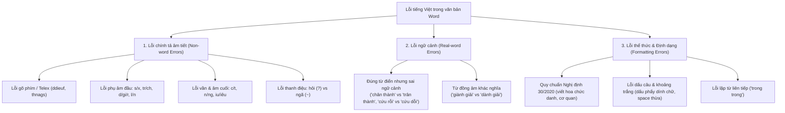
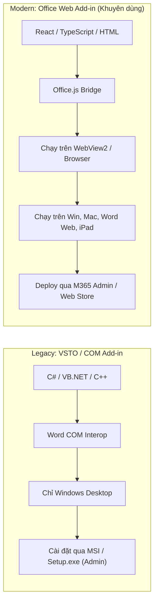
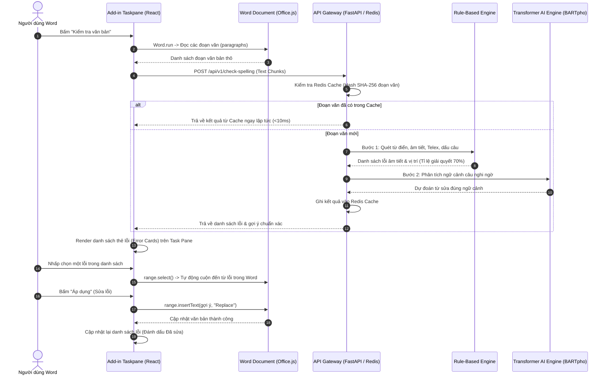
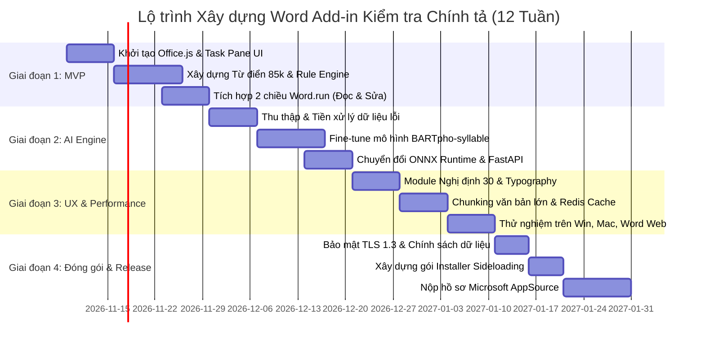

# BÁO CÁO NGHIÊN CỨU & KẾ HOẠCH XÂY DỰNG MICROSOFT WORD ADD-IN KIỂM TRA CHÍNH TẢ TIẾNG VIỆT THẾ HỆ MỚI

---

## MỤC LỤC

1. [Tổng quan nghiên cứu & Phân tích thị trường (Market Research)](#1-tổng-quan-nghiên-cứu--phân-tích-thị-trường)
2. [Phân loại & Cơ chế xử lý lỗi tiếng Việt đặc thù](#2-phân-loại--cơ-chế-xử-lý-lỗi-tiếng-việt-đặc-thù)
3. [Lựa chọn nền tảng & Kiến trúc Add-in (VSTO vs Office.js)](#3-lựa-chọn-nền-tảng--kiến-trúc-add-in)
4. [Kiến trúc hệ thống tổng thể (System Architecture)](#4-kiến-trúc-hệ-thống-tổng-thể)
5. [Thiết kế trải nghiệm người dùng (UX/UI & Interaction Flow)](#5-thiết-kế-trải-nghiệm-người-dùng)
6. [Kế hoạch triển khai chi tiết theo giai đoạn (Roadmap)](#6-kế-hoạch-triển-khai-chi-tiết-theo-giai-đoạn)
7. [Dự toán tài nguyên, rủi ro & Giải pháp phòng ngừa](#7-dự-toán-tài-nguyên-rủi-ro--giải-pháp-phòng-ngừa)
8. [Bộ khung mã nguồn mẫu (Starter Code Blueprint)](#8-bộ-khung-mã-nguồn-mẫu)

---

## 1. TỔNG QUAN NGHIÊN CỨU & PHÂN TÍCH THỊ TRƯỜNG

### 1.1. Hiện trạng các công cụ kiểm tra chính tả trên Microsoft Word

Trong quá trình soạn thảo tài liệu bằng Microsoft Word, lỗi chính tả, sai dấu câu, sai ngữ cảnh và sai quy chuẩn hành chính là nguyên nhân hàng đầu làm giảm chất lượng văn bản. Hiện nay người dùng đang tiếp cận các giải pháp sau:

| Công cụ | Nền tảng / Công nghệ | Ưu điểm | Nhược điểm & Hạn chế |
| :--- | :--- | :--- | :--- |
| **Microsoft Proofing Tools (Gói Tiếng Việt)** | Tích hợp sẵn Word Desktop | Tiện dụng, có sẵn gạch chân đỏ trực tiếp dưới từ. | • Kiểm tra từ điển đơn lẻ (lexicon-based), không hiểu ngữ cảnh.<br>• Tỷ lệ bắt nhầm từ (false positive) cực cao với danh từ riêng, thuật ngữ.<br>• Gợi ý sửa nghèo nàn, thường xuyên sai lệch. |
| **Grammarly / QuillBot / ProWritingAid** | Web, Office.js Add-in, Native App | Trải nghiệm xuất sắc, phân tích ngữ cảnh sâu, gợi ý phong cách viết (tone, style). | • **Không hỗ trợ tiếng Việt**.<br>• Chi phí bản quyền cao (\$12 - \$30/tháng). |
| **LanguageTool** | Java Core, REST API, Office.js / Desktop Add-in | Mã nguồn mở, hỗ trợ đa ngôn ngữ, có Add-in cho Word/Docs. | • Tiếng Việt chỉ ở mức sơ khai (cộng đồng viết rule đơn giản).<br>• Không bắt được các biến thể ngữ âm vùng miền và lỗi ngữ cảnh tiếng Việt phức tạp. |
| **VietSpell / vnSpell / Vspell** | VSTO / COM Add-in, Macro VBA (Word 2000 - 2007) | Từng rất phổ biến ở Việt Nam, có bộ từ điển đồ sộ. | • **Công nghệ lỗi thời**, ngừng phát triển từ lâu.<br>• Không tương thích với Office 365, Word 64-bit, macOS, Word for Web.<br>• Nguy cơ mất an toàn bảo mật macro. |
| **FPT AI / Viettel Cyber / Zalo AI** | Cloud API (NLP Microservice) | Mô hình ngôn ngữ tiếng Việt tương đối tốt. | • Chỉ cung cấp API dạng thô hoặc giải pháp B2B lớn, **chưa có Word Add-in đóng gói hoàn chỉnh cho người dùng cá nhân/văn phòng**. |

### 1.2. Cơ hội và Định vị sản phẩm mục tiêu

* **Tên dự án định hướng:** **VietSpell AI / ChinhTa.ai for Word**
* **Mô hình Add-in:** Modern Office Web Add-in (Office.js + Fluent UI), hoạt động qua Task Pane bên phải tài liệu Word.
* **Giá trị cốt lõi:**
  1. **Hiểu ngữ cảnh sâu (Context-aware):** Không chỉ bắt từ sai hình thức (non-word), mà bắt cả từ đúng hình thức nhưng dùng sai vị trí trong câu (real-word spelling errors).
  2. **Quy chuẩn văn bản hành chính Việt Nam:** Tích hợp kiểm tra lỗi viết hoa cơ quan/chức vụ theo **Nghị định 30/2020/NĐ-CP**.
  3. **Đa nền tảng (Cross-platform):** Chạy đồng nhất trên Word 2016+, Word 2021, Microsoft 365 (Windows & macOS) và Word on the Web.
  4. **Tốc độ phản hồi cực nhanh (< 200ms):** Sử dụng kiến trúc Hybrid (Rule-based lọc sơ bộ + AI phân tích ngữ cảnh).

---

## 2. PHÂN LOẠI & CƠ CHẾ XỬ LÝ LỖI TIẾNG VIỆT ĐẶC THÙ

Khác với tiếng Anh (ngôn ngữ biến tố với khoảng trắng phân tách từ rõ ràng), tiếng Việt là ngôn ngữ đơn lập, âm tiết tính, có thanh điệu và nhiều cặp âm tương đồng phát âm nhưng dị biệt về chính tả.



### 2.1. Ma trận xử lý kỹ thuật cho từng nhóm lỗi

| Nhóm lỗi | Ví dụ thực tế | Cơ chế phát hiện tối ưu | Độ trễ xử lý |
| :--- | :--- | :--- | :--- |
| **Lỗi gõ Telex / Phím bấm** | `chuyển dổi`, `hoạtt động`, `ddieefu` | **Regex + FSM (Finite State Machine) kết hợp từ điển âm tiết tiếng Việt**. Nếu âm tiết không tuân thủ luật kết hợp âm (ví dụ không bao giờ có phụ âm `dd` hay nguyên âm `ee`), đánh dấu lỗi ngay. | < 2ms / trang |
| **Lỗi phụ âm đầu & vần** | `sản xuất` ➔ `xản xuất`<br>`sắp xếp` ➔ `xắp xếp`<br>`man mác` ➔ `man mát` | **SymSpell / Trie + Dictionary 80.000 từ vựng tiếng Việt**. Tính khoảng cách Levenshtein dựa trên bảng nhầm lẫn âm thanh (Soundex / Phonetic Confusion Matrix cho tiếng Việt). | 5 - 10ms / trang |
| **Lỗi hỏi / ngã** | `chia sẻ` ➔ `chia sẽ`<br>`suy nghĩ` ➔ `suy nghãi`<br>`kỹ năng` ➔ `kỷ năng` | **Từ điển từ ghép 2 âm tiết + Bi-gram N-gram model**. Hầu hết từ ghép tiếng Việt có quy tắc phân bố hỏi/ngã cố định. | 10 - 20ms / trang |
| **Lỗi ngữ cảnh (Real-word)** | "Chúng tôi *chân thành* cảm ơn" vs "trân thành"<br>"Hội đồng *phê bình*" vs "phê chuẩn" | **Transformer Seq2Seq / BARTpho / PhoBERT fine-tuned** hoặc **API LLM** (chạy batch theo từng câu). Nhận diện bất thường xác suất từ trong câu. | 100 - 250ms / câu |
| **Lỗi Nghị định 30/2020/NĐ-CP** | "bộ tài chính" ➔ "Bộ Tài chính"<br>"thủ tướng chính phủ" ➔ "Thủ tướng Chính phủ" | **Named Entity Recognition (NER) + Rule-based lexicon cơ quan nhà nước, chức vụ, địa danh**. | 15 - 30ms / trang |
| **Lỗi dấu câu & khoảng trắng** | `công ty ,trách nhiệm .` ➔ `công ty, trách nhiệm.` | **Quy tắc chuẩn hóa Typography (Regex Deterministic Rules)**. | < 1ms / trang |

---

## 3. LỰA CHỌN NỀN TẢNG & KIẾN TRÚC ADD-IN

Trước khi lập trình, việc lựa chọn kiến trúc nền tảng cho Word Add-in là quyết định sống còn. Microsoft hiện cung cấp hai kiến trúc chính:

### 3.1. So sánh chi tiết: VSTO (Legacy) vs Office Web Add-ins (Modern Office.js)



| Tiêu chí | VSTO (.NET / C#) | Office Web Add-in (Office.js + Web) | Đánh giá cho dự án này |
| :--- | :--- | :--- | :--- |
| **Hệ điều hành hỗ trợ** | Chỉ Windows | **Windows, macOS, Word on the Web, iPadOS** | **Office.js thắng tuyệt đối**: Người dùng văn phòng hiện nay dùng cả macOS và Word Online. |
| **Công nghệ phát triển** | C#, .NET Framework, WPF/WinForms | **TypeScript, React, Tailwind CSS, Fluent UI** | **Office.js thắng**: Hệ sinh thái web phong phú, tái sử dụng UI và thư viện frontend hiện đại. |
| **Khả năng cập nhật (Update)** | Phức tạp, phải cập nhật file DLL trên máy từng người dùng qua installer. | **Over-The-Air (OTA)**: Chỉ cần deploy lại Web App trên Server, toàn bộ người dùng nhận bản mới ngay lập tức. | **Office.js thắng**: Tiết kiệm 90% chi phí hỗ trợ kỹ thuật và bảo trì. |
| **Quyền cài đặt** | Cần quyền Administrator trên máy tính. Bị IT nhiều công ty chặn vì lo ngại bảo mật. | **Không cần quyền Admin**: Cài qua sideloading Manifest hoặc cấp phát trung tâm từ Microsoft 365 Admin Center. | **Office.js thắng**: Dễ dàng bán cho khách hàng doanh nghiệp (B2B). |
| **Can thiệp hiển thị trong trang** | Can thiệp sâu, có thể vẽ gạch chân đỏ native. | Hiển thị qua **Task Pane (Cửa sổ sidebar)**, highlight từ bằng Word Range hoặc Comment. | VSTO có lợi thế vẽ gạch chân native, nhưng Office.js khắc phục tốt bằng mô hình Task Pane (tương tự như Grammarly & LanguageTool). |

> [!IMPORTANT]
> **KẾT LUẬN KIẾN TRÚC:** Lựa chọn **Office Web Add-in (Office.js + React + Fluent UI)**. Đây là định hướng chiến lược tương lai của Microsoft (Microsoft 365 Apps), đảm bảo khả năng mở rộng, bảo mật cao và tương thích trên mọi nền tảng.

### 3.2. Cơ chế làm việc của Office.js với tài liệu Word

Add-in chạy trong một sandbox WebView (Microsoft Edge WebView2 trên Windows) và giao tiếp với Word thông qua đối tượng `Word.run`:

1. **Batch Execution & Sync:** Toàn bộ lệnh (đọc văn bản, tìm kiếm, bôi màu, thay thế) được xếp hàng đợi trong bộ nhớ client và chỉ gửi đến Word khi gọi `await context.sync()`. Điều này giúp tối ưu hóa hiệu năng và tránh giật lag Word.
2. **Cơ chế Tracking Offset:** Khi người dùng thay thế một từ (ví dụ: thay từ 3 ký tự bằng từ 5 ký tự), vị trí index của các từ phía sau sẽ bị trượt. Giải pháp: Sử dụng đối tượng `Word.Range` hoặc `Word.ContentControl` để bám theo phạm vi đối tượng thay vì lưu index tuyệt đối.

---

## 4. KIẾN TRÚC HỆ THỐNG TỔNG THỂ

Hệ thống được thiết kế theo mô hình **Hybrid Client-Server** kết hợp giữa tính nhanh nhạy của Client/Edge và sức mạnh phân tích sâu của Backend AI Server.



### 4.1. Chi tiết các thành phần hệ thống

#### 1. Frontend Add-in (Client Layer)

* **Framework:** React 18 + TypeScript + Vite.
* **Thư viện UI:** `@fluentui/react-components` (Fluent UI v9 - thư viện chuẩn của Microsoft giúp Add-in có giao diện hài hòa 100% với giao diện Office 365).
* **Quản lý trạng thái:** Zustand (nhẹ, nhanh hơn Redux, phù hợp môi trường WebView).
* **Word Bridge:** `@microsoft/office-js` kết hợp helper bọc `Word.run`.

#### 2. API Gateway & Cache Layer

* **Framework:** Python FastAPI (bất đồng bộ ASGI, hỗ trợ tốt cho Machine Learning).
* **Caching:** Redis.
  * *Chiến lược Hash-Chunking:* Khi người dùng kiểm tra văn bản 20 trang, văn bản được chia thành các đoạn (paragraphs). Mỗi đoạn được hash SHA-256. Nếu người dùng chỉ sửa 1 câu ở trang 2, các đoạn còn lại không thay đổi sẽ lấy kết quả từ Redis Cache trong 2ms, giảm 85% tải tính toán server.

#### 3. Core Engine: Hai giai đoạn (Two-Stage Pipeline)

* **Giai đoạn 1: Fast Rule & Lexicon Filter (< 10ms)**
  * Kiểm tra cấu trúc âm tiết tiếng Việt (Phụ âm đầu + Âm đệm + Âm chính + Âm cuối + Thanh điệu).
  * Tra cứu Trie / Bloom Filter chứa **85.000 từ tiếng Việt chuẩn** (tổng hợp từ Viện Ngôn ngữ học, từ điển Hoàng Phê).
  * Thuật toán **SymSpell** tối ưu cho bàn phím tiếng Việt (Telex/VNI) với khoảng cách chỉnh sửa Damerau-Levenshtein $\le 2$.
* **Giai đoạn 2: Contextual AI Model (< 150ms)**
  * Mô hình Seq2Seq: **BARTpho-syllable** (VinAI) hoặc **mT5-small** fine-tuned trên tập dữ liệu VSEC (Vietnamese Spelling Correction) và dữ liệu văn bản hành chính/báo chí.
  * Tối ưu suy luận: Chuyển đổi mô hình sang định dạng **ONNX Runtime** với lượng tử hóa INT8 (Quantization) để chạy suy luận CPU tốc độ cao, không cần GPU đắt đỏ.
  * Đưa ra từ gợi ý có xác suất phân bố cao nhất dựa trên ngữ cảnh 5 từ trước và 5 từ sau.

---

## 5. THIẾT KẾ TRẢI NGHIỆM NGƯỜI DÙNG (UX/UI & INTERACTION FLOW)

Trải nghiệm người dùng là yếu tố quyết định người dùng có tiếp tục sử dụng Add-in hay không. Chúng tôi áp dụng triết lý thiết kế **"Non-intrusive & 1-Click Action"** (Không làm phiền & Hành động 1 chạm).

### 5.1. Bố cục Task Pane (Fluent UI v9)

```
+---------------------------------------------------+
|  [Logo] VietSpell AI               [⚙ Cài đặt]    |
+---------------------------------------------------+
|  Trạng thái: 1,420 từ | Phát hiện: 4 lỗi         |
|  [================== 100% ==================]     |
|                                                   |
|  [🔍 Quét toàn bộ]      [📄 Quét vùng chọn]      |
+---------------------------------------------------+
|  DANH SÁCH LỖI (4)                                |
|                                                   |
|  🔴 LỖI CHÍNH TẢ (Âm đầu)                          |
|  Đoạn: "...công ty chúng tôi xản xuất các..."     |
|  Từ lỗi: [ xản xuất ]                             |
|  Gợi ý : [ sản xuất ]  (Độ tin cậy: 99%)          |
|  [ ✓ Áp dụng ]   [ 👁 Xem ]   [ ✕ Bỏ qua ]       |
|  ------------------------------------------------ |
|  🟡 CẢNH BÁO NGỮ CẢNH                             |
|  Đoạn: "...xin chân thành cảm ơn quý khách..."    |
|  Từ lỗi: [ chân thành ]                           |
|  Gợi ý : [ trân trọng ] hoặc giữ nguyên           |
|  [ ✓ Áp dụng ]   [ 👁 Xem ]   [ ✕ Bỏ qua ]       |
|  ------------------------------------------------ |
|  🔵 QUY CHUẨN NGHỊ ĐỊNH 30                        |
|  Đoạn: "...theo quy định của bộ tài chính..."     |
|  Từ lỗi: [ bộ tài chính ]                         |
|  Gợi ý : [ Bộ Tài chính ] (Viết hoa cơ quan)      |
|  [ ✓ Áp dụng ]   [ 👁 Xem ]   [ + Thêm từ điển ]  |
+---------------------------------------------------+
|  [✓ SỬA TẤT CẢ (AUTO FIX ALL)]                     |
+---------------------------------------------------+
```

### 5.2. Các tương tác then chốt (Key Interactions)

1. **Định vị tức thì (Scroll & Highlight):** Khi bấm vào thẻ lỗi hoặc bấm nút "Xem", Add-in gọi lệnh `range.select()` để Word tự động cuộn trang và bôi đen đúng vị trí từ lỗi trong tài liệu.
2. **Sửa lỗi 1 chạm (1-Click Replace):** Bấm "Áp dụng", từ sai lập tức được thay bằng từ đúng, thẻ lỗi biến mất mượt mà (smooth fade-out), tiêu điểm tự động chuyển sang lỗi tiếp theo.
3. **Từ điển cá nhân (Custom Dictionary):** Cho phép người dùng thêm tên riêng, thuật ngữ nội bộ công ty vào danh sách loại trừ bằng 1 nút bấm ("Thêm từ điển"), lưu trữ đồng bộ qua tài khoản.
4. **Sửa tất cả an toàn (Smart Auto-Fix All):** Chỉ tự động sửa các lỗi có độ tin cậy $\ge 98\%$ (lỗi Telex rõ ràng, lỗi chính tả tuyệt đối); các lỗi ngữ cảnh có độ phân vân sẽ giữ lại để người dùng xác nhận thủ công.

---

## 6. KẾ HOẠCH TRIỂN KHAI CHI TIẾT THEO GIAI ĐOẠN

Dự án được phân chia thành **4 giai đoạn (12 tuần)** từ nghiên cứu đến phát hành sản phẩm.



### Chi tiết các công việc theo tuần

#### Giai đoạn 1: Nền tảng & Bản mẫu hoạt động (Tuần 1 - 3: MVP Proof-of-Concept)

* **Tuần 1:**
  * Cài đặt môi trường phát triển: Node.js, Yeoman `yo office`, TypeScript, React 18, `@fluentui/react-components`.
  * Cấu hình file `manifest.xml`, tạo Ribbon Button "Kiểm tra chính tả" trên thanh công cụ Word Home Tab.
* **Tuần 2:**
  * Xây dựng bộ từ điển âm tiết tiếng Việt chuẩn (~85.000 từ).
  * Viết thuật toán kiểm tra tính hợp lệ của âm tiết và bộ lọc gõ nhầm Telex (sử dụng biểu thức chính quy và Trie data structure).
* **Tuần 3:**
  * Lập trình cầu nối Word API: hàm lấy văn bản theo đoạn (`context.document.body.paragraphs`), hàm bôi đen từ lỗi (`range.select()`), hàm thay thế từ (`range.insertText()`).
  * Hoàn thành phiên bản thử nghiệm nội bộ chạy trên máy tính phát triển (Sideloading).

#### Giai đoạn 2: Tích hợp Trí tuệ Nhân tạo & Ngữ cảnh (Tuần 4 - 6)

* **Tuần 4:**
  * Thu thập dữ liệu huấn luyện (VSEC, Wikipedia tiếng Việt, tập dữ liệu báo chí được gán nhãn lỗi chính tả nhân tạo qua quy tắc nhiễu âm thanh).
* **Tuần 5:**
  * Fine-tune mô hình ngôn ngữ Seq2Seq `vinai/bartpho-syllable` chuyên biệt cho nhiệm vụ sửa lỗi ngữ cảnh tiếng Việt.
  * Tối ưu hóa mô hình bằng phương pháp lượng tử hóa (INT8 Quantization) và xuất sang ONNX Runtime để giảm kích thước và tăng tốc độ suy luận gấp 4 lần.
* **Tuần 6:**
  * Xây dựng Backend Service trên Python FastAPI. Đóng gói Docker container.
  * Kết nối Task Pane Add-in với Backend API qua giao thức HTTPS.

#### Giai đoạn 3: Tối ưu hiệu năng, Quy chuẩn Nghị định 30 & Kiểm thử (Tuần 7 - 9)

* **Tuần 7:**
  * Phát triển module kiểm tra thể thức văn bản hành chính theo Nghị định 30/2020/NĐ-CP (nhận diện và chuẩn hóa viết hoa cơ quan, tổ chức, danh hiệu).
  * Bổ sung module chuẩn hóa dấu câu và khoảng trắng (Typography auto-formatter).
* **Tuần 8:**
  * Tối ưu hiệu năng khi xử lý tài liệu dài (> 50 trang): Phân đoạn song song (Chunking), sử dụng cơ chế Server-Sent Events (SSE) để stream kết quả theo thời gian thực thay vì bắt người dùng chờ toàn bộ văn bản.
  * Tích hợp Redis Cache dựa trên SHA-256 hash của từng đoạn văn bản.
* **Tuần 9:**
  * Kiểm thử tương thích trên toàn bộ các môi trường: Word 2019/2021 Desktop (Windows), Word for Mac, Word on the Web (Chrome/Edge/Safari).

#### Giai đoạn 4: Đóng gói, Bảo mật & Triển khai phát hành (Tuần 10 - 12)

* **Tuần 10:**
  * Thiết lập chính sách bảo mật dữ liệu nghiêm ngặt: Mã hóa truyền tải TLS 1.3, cam kết Zero Data Retention (không lưu trữ nội dung văn bản của người dùng trên cơ sở dữ liệu server sau khi xử lý xong).
  * Triển khai tính năng Từ điển cá nhân lưu cục bộ (Local Storage) hoặc đồng bộ bảo mật.
* **Tuần 11:**
  * Đóng gói bản cài đặt nội bộ cho doanh nghiệp: Hướng dẫn cài đặt tập trung qua Microsoft 365 Admin Center (Centralized Deployment) hoặc qua script Powershell cho Word Desktop.
* **Tuần 12:**
  * Chuẩn bị hồ sơ đăng ký xuất bản lên kho ứng dụng chính thức của Microsoft (**Microsoft AppSource**): hình ảnh mockup, video demo, chính sách quyền riêng tư (Privacy Policy), điều khoản dịch vụ (Terms of Service).

---

## 7. DỰ TOÁN TÀI NGUYÊN, RỦI RO & GIẢI PHÁP PHÒNG NGỪA

### 7.1. Dự toán tài nguyên & Chi phí hạ tầng

| Hạng mục | Giải pháp đề xuất | Chi phí ước tính (Giai đoạn đầu) |
| :--- | :--- | :--- |
| **Máy chủ API & Suy luận AI** | 1x Cloud VPS (4 vCPU, 8GB RAM) chạy Docker ONNX Runtime CPU | ~ \$30 - \$50 / tháng |
| **Bộ nhớ đệm (Caching)** | Redis Cloud Free / Managed Redis 1GB | ~ \$0 - \$15 / tháng |
| **Hosting Frontend Taskpane** | Vercel / Cloudflare Pages (Static Web Hosting + CDN) | Miễn phí (Hỗ trợ băng thông cao) |
| **Tên miền & SSL** | Domain .vn hoặc .com + Cloudflare SSL | ~ \$15 - \$25 / năm |
| **Tài khoản Microsoft Partner** | Đăng ký để publish Add-in lên AppSource | ~ \$19 (Phí một lần cho cá nhân) |

### 7.2. Phân tích rủi ro & Kế hoạch ứng phó

| Rủi ro kỹ thuật | Mức độ | Hậu quả | Giải pháp ứng phó cụ thể |
| :--- | :--- | :--- | :--- |
| **Văn bản bị trượt vị trí (Offset mismatch)** | Cao | Khi sửa 1 từ, các từ sau bị bôi đen lệch vị trí do thay đổi độ dài văn bản. | Sử dụng đối tượng `Word.Range` neo theo đoạn văn bản (`paragraph`) thay vì lưu chỉ mục ký tự toàn tài liệu. Sau mỗi thao tác sửa, chỉ re-sync lại phạm vi của đoạn văn bản đó. |
| **Độ trễ cao với văn bản hàng trăm trang** | Trung bình | Gây đơ giao diện Task Pane hoặc timeout mạng. | Áp dụng kỹ thuật **Lazy-scanning / Streaming**: Chia tài liệu thành các khối 1.000 từ. Quét khối màn hình người dùng đang xem trước, các khối sau quét ngầm trong hàng đợi. |
| **Lo ngại bảo mật tài liệu doanh nghiệp** | Cao | Doanh nghiệp không đồng ý gửi văn bản mật lên Cloud Server. | Cung cấp 2 chế độ: <br>1. **Cloud AI Mode** (cho người dùng phổ thông).<br>2. **Offline/Local-Only Mode** (sử dụng Rule-based Engine chạy 100% bằng WebAssembly/JS trực tiếp trong trình duyệt của người dùng, không gửi bất kỳ byte nào ra internet). |
| **Bắt nhầm từ chuyên ngành / Tên riêng** | Trung bình | Gây khó chịu cho người dùng khi báo lỗi từ đúng. | Tích hợp thuật toán nhận diện chữ viết hoa thông minh (NER), tự động bỏ qua các từ viết hoa liên tiếp trừ khi đứng đầu câu; cung cấp nút "Bỏ qua tất cả" và "Thêm vào từ điển cá nhân". |

---

## 8. BỘ KHUNG MÃ NGUỒN MẪU (STARTER CODE BLUEPRINT)

Dưới đây là thiết kế kiến trúc mã nguồn và các file cốt lõi để bắt đầu lập trình ngay dự án:

### 8.1. Cấu trúc thư mục dự án chuẩn (Monorepo)

```
vietspell-word-addin/
├── manifest.xml                 # Cấu hình Add-in đăng ký với Microsoft Word
├── package.json                 # Quản lý dependencies (Office.js, React, FluentUI)
├── tsconfig.json                # Cấu hình TypeScript
├── src/
│   ├── index.tsx                # Điểm khởi động Webview Office
│   ├── taskpane/
│   │   ├── index.html           # Khung HTML nạp Office.js
│   │   ├── components/
│   │   │   ├── App.tsx          # Giao diện chính Task Pane
│   │   │   ├── ErrorCard.tsx    # Thẻ hiển thị từng lỗi & nút sửa
│   │   │   ├── Header.tsx       # Thanh trạng thái & cài đặt
│   │   │   └── StatsBar.tsx     # Thống kê số từ, số lỗi
│   │   └── services/
│   │       ├── wordService.ts   # Cầu nối tương tác với Word DOM (Office.js)
│   │       └── spellApi.ts      # Gọi API kiểm tra chính tả
│   └── assets/                  # Icon 16x16, 32x32, 80x80 cho Ribbon
└── server/                      # Backend API Service (Python FastAPI)
    ├── main.py                  # API endpoints
    ├── core/
    │   ├── vietnamese_rules.py  # Bộ lọc âm tiết & quy tắc tiếng Việt
    │   └── onnx_inference.py    # Suy luận mô hình BARTpho ONNX
    └── data/
        └── vietnamese_words.txt # Từ điển 85.000 từ chuẩn
```

### 8.2. File `manifest.xml` chuẩn cho Word Add-in

```xml
<?xml version="1.0" encoding="UTF-8"?>
<OfficeApp 
          xmlns="http://schemas.microsoft.com/office/appforoffice/1.1" 
          xmlns:xsi="http://www.w3.org/2001/XMLSchema-instance" 
          xsi:type="TaskPaneApp">
  <Id>b2a1e670-3d5f-4a38-8c19-94f87a32d1e0</Id>
  <Version>1.0.0.0</Version>
  <ProviderName>VietSpell Team</ProviderName>
  <DefaultLocale>vi-VN</DefaultLocale>
  <DisplayName DefaultValue="VietSpell AI - Kiểm tra Chính tả" />
  <Description DefaultValue="Kiểm tra chính tả, ngữ cảnh và chuẩn hóa văn bản hành chính tiếng Việt." />
  <IconUrl DefaultValue="https://localhost:3000/assets/icon-32.png" />
  <HighResolutionIconUrl DefaultValue="https://localhost:3000/assets/icon-80.png" />
  <SupportUrl DefaultValue="https://vietspell.ai/support" />
  <AppDomains>
    <AppDomain>https://localhost:3000</AppDomain>
    <AppDomain>https://api.vietspell.ai</AppDomain>
  </AppDomains>
  <Hosts>
    <Host Name="Document" />
  </Hosts>
  <DefaultSettings>
    <SourceLocation DefaultValue="https://localhost:3000/taskpane.html" />
  </DefaultSettings>
  <Permissions>ReadWriteDocument</Permissions>
  <VersionOverrides xmlns="http://schemas.microsoft.com/office/taskpaneappversionoverrides" xsi:type="VersionOverridesV1_0">
    <Hosts>
      <Host xsi:type="Document">
        <DesktopFormFactor>
          <ExtensionPoint xsi:type="PrimaryCommandSurface">
            <CustomTab id="VietSpellTab">
              <Group id="VietSpellGroup">
                <Label DefaultValue="VietSpell AI" />
                <Icon>
                  <bt:Image size="16" resid="Icon.16x16" />
                  <bt:Image size="32" resid="Icon.32x32" />
                  <bt:Image size="80" resid="Icon.80x80" />
                </Icon>
                <Control xsi:type="Button" id="CheckSpellingButton">
                  <Label DefaultValue="Kiểm tra chính tả" />
                  <Supertip>
                    <Title DefaultValue="Kiểm tra chính tả tiếng Việt" />
                    <Description DefaultValue="Mở cửa sổ phân tích lỗi chính tả và chuẩn hóa văn bản." />
                  </Supertip>
                  <Icon>
                    <bt:Image size="16" resid="Icon.16x16" />
                    <bt:Image size="32" resid="Icon.32x32" />
                    <bt:Image size="80" resid="Icon.80x80" />
                  </Icon>
                  <Action xsi:type="ShowTaskpane">
                    <TaskpaneId>VietSpellTaskpane</TaskpaneId>
                    <SourceLocation resid="Taskpane.Url" />
                  </Action>
                </Control>
              </Group>
              <Label DefaultValue="Chính tả AI" />
            </CustomTab>
          </ExtensionPoint>
        </DesktopFormFactor>
      </Host>
    </Hosts>
    <Resources>
      <bt:Images>
        <bt:Image id="Icon.16x16" DefaultValue="https://localhost:3000/assets/icon-16.png" />
        <bt:Image id="Icon.32x32" DefaultValue="https://localhost:3000/assets/icon-32.png" />
        <bt:Image id="Icon.80x80" DefaultValue="https://localhost:3000/assets/icon-80.png" />
      </bt:Images>
      <bt:Urls>
        <bt:Url id="Taskpane.Url" DefaultValue="https://localhost:3000/taskpane.html" />
      </bt:Urls>
    </Resources>
  </VersionOverrides>
</OfficeApp>
```

### 8.3. Module tương tác Word API (`src/taskpane/services/wordService.ts`)

```typescript
/* global Word */

export interface SpellErrorItem {
  id: string;
  originalWord: string;
  suggestedWord: string;
  paragraphIndex: number;
  sentenceContext: string;
  reason: string;
  category: "spelling" | "context" | "typography";
}

/**
 * Đọc tất cả các đoạn văn bản trong tài liệu Word
 */
export async function getDocumentParagraphs(): Promise<string[]> {
  return await Word.run(async (context) => {
    const paragraphs = context.document.body.paragraphs;
    paragraphs.load("text");
    await context.sync();
    return paragraphs.items.map((p) => p.text);
  });
}

/**
 * Bôi đen và cuộn màn hình đến từ bị lỗi trong văn bản
 */
export async function highlightAndScrollToWord(
  paragraphIndex: number,
  wordToFind: string
): Promise<void> {
  await Word.run(async (context) => {
    const paragraph = context.document.body.paragraphs.getFirst();
    const paragraphs = context.document.body.paragraphs;
    paragraphs.load("items");
    await context.sync();

    if (paragraphIndex < paragraphs.items.length) {
      const targetPara = paragraphs.items[paragraphIndex];
      // Tìm kiếm từ trong đoạn cụ thể
      const searchResults = targetPara.search(wordToFind, { matchCase: true, matchWholeWord: true });
      searchResults.load("items");
      await context.sync();

      if (searchResults.items.length > 0) {
        const targetRange = searchResults.items[0];
        // Bôi vàng từ lỗi và chọn nó
        targetRange.select();
        await context.sync();
      }
    }
  });
}

/**
 * Thay thế từ lỗi bằng từ đúng chuẩn
 */
export async function replaceWordInDocument(
  paragraphIndex: number,
  oldWord: string,
  newWord: string
): Promise<boolean> {
  return await Word.run(async (context) => {
    const paragraphs = context.document.body.paragraphs;
    paragraphs.load("items");
    await context.sync();

    if (paragraphIndex < paragraphs.items.length) {
      const targetPara = paragraphs.items[paragraphIndex];
      const searchResults = targetPara.search(oldWord, { matchCase: true, matchWholeWord: true });
      searchResults.load("items");
      await context.sync();

      if (searchResults.items.length > 0) {
        const targetRange = searchResults.items[0];
        targetRange.insertText(newWord, Word.InsertLocation.replace);
        await context.sync();
        return true;
      }
    }
    return false;
  });
}
```

### 8.4. Backend Service cơ sở (`server/main.py`)

```python
from fastapi import FastAPI, HTTPException
from fastapi.middleware.cors import CORSMiddleware
from pydantic import BaseModel
from typing import List
import re

app = FastAPI(title="VietSpell Core Engine API", version="1.0.0")

# Cấu hình CORS để Add-in WebView có thể gọi API mà không bị chặn
app.add_middleware(
    CORSMiddleware,
    allow_origins=["*"],
    allow_credentials=True,
    allow_methods=["*"],
    allow_headers=["*"],
)

class CheckRequest(BaseModel):
    paragraphs: List[str]

class SpellErrorResponse(BaseModel):
    id: str
    originalWord: str
    suggestedWord: str
    paragraphIndex: int
    sentenceContext: str
    reason: str
    category: str

# Từ điển mẫu (sẽ nạp từ file 85k từ khi khởi động)
STANDARD_DICTIONARY = {"sản xuất", "sắp xếp", "công nghệ", "kinh doanh", "chia sẻ", "Bộ Tài chính"}
COMMON_TYPOS = {
    "xản xuất": ("sản xuất", "Lỗi phụ âm đầu x/s"),
    "xắp xếp": ("sắp xếp", "Lỗi phụ âm đầu x/s"),
    "kinh zoanh": ("kinh doanh", "Lỗi phụ âm z/d"),
    "chia sẽ": ("chia sẻ", "Lỗi thanh điệu hỏi/ngã"),
    "bộ tài chính": ("Bộ Tài chính", "Viết hoa cơ quan nhà nước theo NĐ 30/2020"),
}

@app.post("/api/v1/check-spelling", response_model=List[SpellErrorResponse])
async def check_spelling(payload: CheckRequest):
    errors = []
    error_counter = 0

    for p_idx, text in enumerate(payload.paragraphs):
        if not text.strip():
            continue

        # Tách từ và cụm từ để kiểm tra
        for typo, (suggestion, reason) in COMMON_TYPOS.items():
            pattern = re.compile(re.escape(typo), re.IGNORECASE)
            for match in pattern.finditer(text):
                error_counter += 1
                cat = "typography" if "NĐ 30" in reason else "spelling"
                errors.append(
                    SpellErrorResponse(
                        id=f"err_{p_idx}_{error_counter}",
                        originalWord=match.group(0),
                        suggestedWord=suggestion,
                        paragraphIndex=p_idx,
                        sentenceContext=text[max(0, match.start()-20): min(len(text), match.end()+20)],
                        reason=reason,
                        category=cat,
                    )
                )

    return errors

if __name__ == "__main__":
    import uvicorn
    uvicorn.run(app, host="0.0.0.0", port=8000)
```

---

## 9. KẾT LUẬN & KHUYẾN NGHỊ BƯỚC ĐI TIẾP THEO

Việc tự xây dựng một Add-in kiểm tra chính tả tiếng Việt trên Microsoft Word là hoàn toàn khả thi và có tiềm năng ứng dụng rất lớn nhờ sự kết hợp giữa:

1. **Công nghệ Office Web Add-in hiện đại (Office.js):** Vượt qua hoàn toàn các giới hạn cài đặt cục bộ và tính tương thích nền tảng của các thế hệ Add-in cũ.
2. **Mô hình AI Hybrid:** Giải quyết bài toán tốc độ tức thì cho văn bản dài, đồng thời bắt được lỗi ngữ cảnh mà các bộ gõ hay từ điển truyền thống không làm được.
3. **Giá trị văn phòng đặc thù:** Đón đầu nhu cầu chuẩn hóa thể thức văn bản hành chính theo Nghị định 30/2020/NĐ-CP tại các cơ quan, trường học và doanh nghiệp Việt Nam.

**Bước đi khuyến nghị tiếp theo:**

* Khởi tạo thư mục mã nguồn ban đầu trong thư mục dự án này (`f:\AI\8.chinhta`).
* Tạo khung dự án Office Add-in bằng TypeScript và React với Fluent UI.
* Thử nghiệm việc đọc và thay thế từ thực tế trong file Word mẫu.
