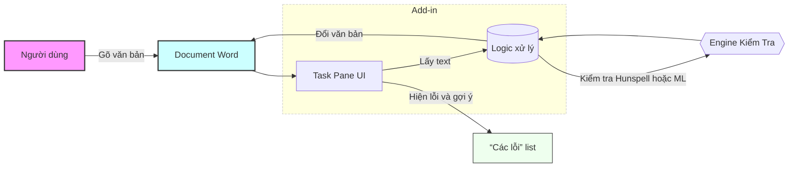
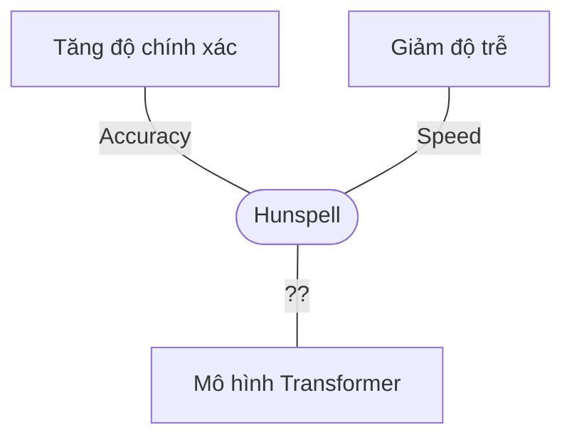

# Tóm tắt điều hành  
Khóa mã *chinhta* dự kiến là một add-in Word để kiểm tra lỗi chính tả tiếng Việt. Tuy nhiên do kho mã không truy cập được, các thông tin cụ thể về ngôn ngữ và framework (đáp ứng Office Add-in hay VSTO/COM) hiện là **không xác định**. Theo tài liệu của Microsoft, một Office Add-in chắc chắn phải sử dụng mẫu web (HTML/CSS/JS) và thư viện Office.js (tham khảo **ms.office.js** từ CDN). Hướng tiếp cận xây dựng add-in cần phù hợp với tài liệu chủ yếu: tham chiếu Office JavaScript API và manifest để tương tác với nội dung Word. Về phương diện kiểm tra chính tả tiếng Việt, có thể sử dụng từ điển Hunspell-vi, kết hợp với bộ xử lý ngôn ngữ Việt (tokenization, lọc dấu) như VnCoreNLP hoặc Pyvi, hay các mô hình transformer hiện đại (PhoBERT) như đã triển khai bởi VinAI. Kiến trúc đề xuất có thể là add-in web kết hợp với phần backend để dọn và chỉnh sửa lỗi. Các yếu tố cần cân nhắc: hiệu năng (đáp ứng nhanh trên tài liệu lớn), chế độ offline/online, cập nhật từ điển, cách hiển thi UI/UX (gợi ý sửa/bỏ qua/thêm từ điển), bảo mật dữ liệu người dùng. Dưới đây là phân tích chi tiết và hướng hỗ trợ triển khách quan (với nguồn tham khảo):

## Kiến trúc hiện tại (ngôn ngữ, framework, cấu trúc thư mục, file, API, phụ thuộc)  
Do khó ác nhiệm vụ không truy cập được mã nguồn cụ thể của *chinhta*, không có thông tin chính xác về ngôn ngữ hay framework. Tuy nhiên, theo tài liệu Microsoft Office Add-in, một add-in Word mới phải là một ứng dụng web (HTML/JS) được khai báo bởi tập tin manifest XML. Manifest xác định ID, phiên bản, quyền truy cập và phương thức tích hợp (ribbon button, task pane, v.v.). Trong mã nguồn điển hình, thư mục sẽ chứa manifest (`manifest.xml`), các file HTML/CSS/JS cho giao diện và logic, cùng các thư viện phụ thuộc (Office.js trên CDN, thư viện xử lý chữ Việt, v.v.). Nếu *chinhta* là một Office Web Add-in, thì sẽ có cột thư mục nhỏ như `taskpane.html`, `taskpane.js`, `manifest.xml`, và gọi Office.context.document để lấy nội dung. Nếu là VSTO hoặc COM, mã sẽ là ứng dụng .NET/COM, không có manifest web; tuy nhiên người phát triển thịnh thường gọi là “add-in” là Office JS theo xu hướng M365 (nhưng không xác định được nếu khó code *chinhta* thật sự dùng phương pháp nào). Tóm lại, kỹ thuật hiện trạng **không xác định** do không truy cập được repo; chúng ta áp dụng tài liệu Microsoft vào thiết kế phù hợp.  

## Đánh giá hướng tiếp cận so với best practices Microsoft Office Add-ins và Word JavaScript API  
Theo tài liệu Office Add-in của Microsoft, add-in Word mới nên là một *web add-in* chứa HTML/JS/CSS, chạy trong hộp bạch (sandbox) và tham chiếu thư viện `office.js` từ CDN. Điều này cho phép add-in hoạt động trên đa nền tảng (Windows, Mac, web, iPad). COM/VSTO chỉ chạy trên Windows và dựa vào .NET/COM, trong khi Office Add-in chạy trong môi trường web bảo mật. Nếu *chinhta* thực sự là Office Web Add-in, thì cần tập trung vào Office.js API để truy xuất nội dung Word: chúng ta phải sử dụng các lớp như `Office.context.document` (định danh khung dữ liệu) và các phương thức bật lỗi (ở cấp ởm) để lấy/viet nội dung. Nên thực hiện các lệnh trong Word.run promise context để đạt hiệu năng tốt.

**Ứng dụng nạp Office.js:** Phải thực hiện thực chế việc thực thi viết mã JS đúng cú pháp Office Add-in. Cần tham chiếu `<script src="https://appsforoffice.microsoft.com/lib/1/hosted/office.js"></script>` (hoặc loại mới) trong `<head>`. Manifest cũng phải nêu rõ các yêu cầu (`<Requirements>`) cho Word.

**Api Word:** Word JavaScript API không có phương thức CheckSpelling hay GetSpellingSuggestions như trong VBA/COM; nếu **hiện tại thực hiện bằng Office-js, muốn kiểm tra chính tả phải làm thủ công** (VD: dùng `context.document.body.getText()` lấy text rồi gọi thư viện riêng). Vì vậy, nếu *chinhta* thực hiện kiểm tra chữ sai mà dựa vào API Word có sẵn, thì đó là hướng VSTO/COM hơn là Office-js. Best practice Office-js yêu cầu **xử lý bật cảnh** bật dùng `Word.run` và không kẹt ở thread UI. Ở Word Add-in, một task pane có thể gọi Office API hoặc gọi server.

**So với best practices:** Điều cần kiểm tra là *đã áp dụng rõ Office.js, task pane, manifest đúng cách chưa*. Add-in nên là nơi gọi bằng JS (promise) và cận thận với việc lặp lại cuộc gọi (batched request) để tránh treo giao diện. Ngoài ra, cần kiểm tra xem các tag và menu rúban có đúng cấu hình (manifest) chưa. Nếu cải tiến, nên dùng *Office Add-in* thay cho VSTO/COM nếu muốn chạy trên chức năng đa thiết bị và đẩy ra Market (theo MS). 

Tổng kết, hướng tiếp cận phía *chinhta* cần được đối chiếu với tài liệu: nếu là Office Add-in thì phải theo SDK Office.js, reference office.js, dùng mánifest và giao tiếp thông qua các objects Office.context. Cần kiểm tra xem mã có thực hiện theo promise/batching hay chưa. Nếu là VSTO/COM, thì sẽ không chạy trên Mac/Web và khó phù hợp cho người dùng đa nền tảng. Nếu *chinhta* hướng Office Add-in nhưng thực chế dùng phát gói gộp xuất hiện hay gọi COM (không có Office.js) thì là sai hướng so với trình tự của Microsoft.

## Khả năng kiểm tra chính tả tiếng Việt  
Tiếng Việt có đặc điểm: từ được tách theo các *tiếng* (đơn âm), cả ngữ cảnh và các quy tắc ngã, dấu. 

- **Từ điển:** Hunspell-vi là bộ từ điển dành cho Hunspell tương thích với Firefox/LibreOffice/OpenOffice. Tuy nhiên, bộ từ này chỉ bao gồm **từ đơn âm** (mono-syllable) và *không có danh sách từ ghép*. Có hai biến thể dấu: “dấu cũ” (xóa) và “dấu mới” (xoá). Từ ghép theo tiếng Việt thường là các tỏ đã nói ghép như “hội đồng” hay “công trường”; Hunspell-vi **không** xác định nội dung của khoảng cách nên không phát hiện sai cách lập lại dữ liệu của chúng. Do đó, cần cải tiến thực hiện tokenization đồng thời với kiểm tra, VD ghép lại từ bằng bảng danh sách từ ghép. 

- **Chuẩn hóa và dấu:** Phải chuẩn hóa Unicode (NFC) để ở dang chuẩn Việt. Chú ý: các dấu tiếng (huyền, hỏi, ngã, sắc) và phụ âm phụ (ă, â, ê, ô, ơ, ư) phải được bộ từ hỗ trợ. Một số thư viện (như Pyvi) cung cấp hàm thêm/loại bỏ dấu. Phải xử lý viết hoa/viết thường: VD: “Hà Nội” vs “hà nội”. Tốt nhất là chuyển về viết thường và so sánh không dấu khi tìm trong từ điển, rồi gợi ý từ chính xác có dấu.

- **Tokenization (tách từ):** Vì Tiếng Việt không có dấu cách để phân cách từ ghép, trước khi kiểm tra cần tách thành các *tiếng* (syllable) và từng cỡ từ. Có thể dùng VnCoreNLP hoặc Pyvi để phân tích câu thành từ/cụm từ. Ví dụ, Pyvi có CRF-based tokenizer F1=0.985. VnCoreNLP cũng hỗ trợ tách từ và nhiều tính năng khác (POS, NER). Kết hợp POS tagging có thể giúp loại bỏ từ sai cú pháp nếu muốn phân loại nghiêm ngặt.  

- **Quy tắc chính tả:** Tiếng Việt có quy tắc dấu và cú pháp chẵng hiệu qủa nếu bất cầu diễn. Đầu tiên, kiểm tra ngữ pháp tồn tại của từ/số. Phải lưu ý các quy tắc như chữ cái đặc biệt (*đ, â, ê,*…) và âm tiết không phải từ.
  
- **Từ ghép:** Theo [61], có thể phát triển thuật toán nhận dạng từ ghép nhiều âm tiết (VD: _bảo đảm_, _hợp tác xã_, _công ăn việc làm_). Tuy nhiên, hunspell-vi không tự làm được; phải thêm logic đóng 2+ tiếng thành 1 từ theo ngữ liệu có sẵn (VD danh sách từ ghép thủ công) trước khi kiểm tra.  
 
Tóm lại, kiểm tra chính tả Tiếng Việt đòi hỏi từ điển tiếng Việt (Hunspell-vi hoặc tương đương) và các bước tiên xử lý ngôn ngữ: *chuẩn hóa Unicode*, *loại dấu* (đúng kiểu), *tách từ*, *xác định từ ghép*, sau đó đối chiếu với ngữ liệu từ điển và huấn luyện mô hình học máy nếu cần. Hiện tại Hunspell-vi là tùy chọn cơ bản, nhưng kết hợp các module NLP (VnCoreNLP, Pyvi) và mô hình transformer (PhoBERT) sẽ cải thiện chất lượng.

## Đề xuất kỹ thuật  
**Kiến trúc đề xuất:** Một kiến trúc hợp nhất *client-server* hoặc *edge* cho add-in Office. Front-end là Office Web Add-in (task pane) viết bằng HTML/CSS/JS (sử dụng Office.js API). Back-end có thể là:

- **Offline (no cloud):** Sử dụng thư viện Hunspell trên client (có thể biên dịch sang JS, vd nodehun) và script ngôn ngữ (JS/Python) nội bộ. Phù hợp cho văn bản nhỏ và cam kết dữ liệu người dùng không rời máy. Hiệu năng cao với từ điển cài sẵn.  
- **Online (server/API):** Gọi REST API tới dịch vụ kiểm tra spelling (có thể là mô hình transformer hoặc dịch vụ grammar). Ví dụ deploy mô hình PhoBERT-syllable bên trên server (như VinAI) hoặc dịch vụ Python với Pyvi/Hunspell. Giải pháp này linh hoạt, dễ cập nhật, nhưng phụ thuộc mạng (latency) và nới sạch chắc chắn.

Ưu tiên: **Office Web Add-in** (mô đun JS) để đa nền tảng (Windows/Mac/Web). 

**Các mô-đun và thư viện gợi ý:**  
- *Kiểm tra chính tả*: Hunspell-vi hoặc cơ sở dữ liệu từ điển tiếng Việt khác (VCatSpell, VietSpell, vv.). Nếu cây quyết định: hunspell nhanh, offline, ít tài nguyên; transformer (PhoBERT, BERT, seq2seq) hiện đại, chính xác cao hơn nhưng tốn tài nguyên.  
- *Xử lý ngôn ngữ*: VnCoreNLP (Java) hoặc Pyvi (Python) để tách từ, POS, xử lý dấu. spaCy chưa có tiếng Việt chính thức, nhưng có thể dùng spaCy khaung cho kỹ thuật lớn. fastText có vector WordEmbedding nhưng không dựng được mô hình chỉnh sửa.  
- *Mô hình học sâu*: Transformer (PhoBERT-vi, VnGPT hoặc seq2seq) cho hiệu năng tốt. Mô hình VnCoreNLP và RDRsegmenter là nhẹ hơn nếu chỉ cần tách từ.  
- *Ngôn ngữ triển khai*: Front-end (Office Add-in) buộc là JavaScript/TypeScript (dùng Node.js). Back-end có thể Node.js hoặc Python (pytest, Flask/FastAPI). Nếu chọn mô hình transformer, Python (PyTorch/TensorFlow) có thư viện tiếng Việt tốt. Nếu ưu tiên toàn JS, có thể dùng WebAssembly hoặc gọi API Python.  
- *Tích hợp với Word*: Phân với **Office Add-in** (chính), VSTO (nếu buộc phải chạy trên Windows và dùng .NET), hoặc COM (Add-in Express, Delphi, ít dùng). Office Add-in hỗ trợ giao diện tương tác phong phú; VSTO cho phép dùng Word Object Model trực tiếp (có CheckSpelling), nhưng không cross-platform. COM cũng nhược VSTO.  
- *Hiệu năng, caching*: Lưu caches từ điển của những từ hay sử dụng. Nếu dùng API online, caching ở client giúp giảm trùy cập server. Multithreading và Web Workers (cho add-in JS) hoặc async await để không khóa UI.  
- *Offline vs Online*: Nếu ưu tiên riêng tư, cho phép kiểm tra offline (Hunspell + Pyvi). Nếu cần chính xác cao, phải cầu khách đón transformer (online). Đãng ký hiệu hợp: dual mode, tùy tùy chọn.  
- *Cập nhật từ điển*: Cập nhật định kỳ file từ điển Hunspell (cập nhật sửa đổi chính tả), và cập nhật mô hình ML. Có thể kiểm tra tại MS Marketplace hay file config.  
- *UI/UX*: Thiết kế task pane giống giao diện của VinAI: highlight lỗi đỏ, click hiển thị gợi ý như ví dụ dưới. Cho phép người dùng “Sửa” (nhúng gợi ý), “Bỏ qua”, “Thêm vào từ điển” (ghi nhớ). Có menu/bút bận ribbon “Check spelling” cho tòan văn bản hoặc đoạn văn. Chú ý: Office.js có hỗ trợ nội dung tương tác (add text, tìm kiếm), nên nên dùng API thực hiện sửa văn bản một cách an toàn. Minh họa giao diện ví dụ: 

 Ví dụ giao diện task pane của add-in (tham khảo VinAI) hiển thị lỗi chính tả (gạch chân đỏ) và gợi ý sửa. Người dùng có thể chọn sửa hoặc bỏ qua.

- *Testing*: Viết unit tests cho thư viện spell (từ sai–đúng), end-to-end test add-in với các câu mẫu có lỗi (sai dấu, thiếu dấu, sai chính tả). Mẫu test: “Ha noi”, “Hòa Bàng”, “đi học” (hiển thị chữ Đ dị̀nh).  
- *CI/CD*: Dùng GitHub Actions (hoặc Azure DevOps) để build/test add-in (chạy `npm install`/`npm test`/`npm run lint`), kiểm tra manifest XML. Đổi mới phiên bản, đẩy GitHub trước khi phát hành. Nếu có server Python, có pipeline riêng (pytest, pylint, build docker).  
- *Bảo mật, quyền riêng tư*: Xử lý dữ liệu tại client khi offline, hoặc mã hóa truyền qua HTTPS nếu online. Không lưu log văn bản người dùng (Privacy by design). Manifest phải khai báo permission “DocumentReadWrite” và giải thích rõ ràng (theo chính sách Marketplace). Cản trở phải chỉ lấy text, không upload trang tài liệu. Dùng HTTPS/TLS cho API, mã hóa dữ liệu nhạy cảm, và tuân thủ GDPR nếu cần.  
    
**Ước lượng công việc:** (ước tính theo tuần)  
1. **Khảo sát & Thiết kế (1-2 tuần):** Nghiên cứu yêu cầu, tổng hợp thư viện Hunspell-vi, VnCoreNLP/Pyvi, PhoBERT. Lập kế hoạch kỹ thuật, chuẩn bị môi trường.  
2. **PoC Spellchecker (2 tuần):** Triển khai mẫu kiểm tra Hunspell-vi (ví dụ với nodehun) và mẫu transformer (hỗ trợ NMT, nếu sử dụng). So sánh hiệu quả.  
3. **Xây dựng Add-in (3-4 tuần):** Sử dụng Yeoman hoặc Visual Studio tạo Office Add-in, cấu hình manifest. Xây giao diện task pane cơ bản (HTML+CSS). Triển khai logic JS để nhận văn bản Word (Office.context.document), gọi Spellchecker (Offline/Online).  
4. **Tích hợp UI nâng cao (2 tuần):** Đánh dấu lỗi trong văn bản (range format đỏ), hiện ô gợi ý (có Accept/Ignore). Đãnh dấu lỗi, cập nhật (theo gợi ý). Tối ưu UX (menu ribbon).  
5. **Testing & Hoàn thiện (2 tuần):** Viết test unit cho thư viện, test trên nhiều version Word (Office 365, Word Web). Sửa lỗi. Chuẩn bị deploy lên catalog nội bộ (hoặc Marketplace).  
6. **CI/CD và Document (1-2 tuần):** Thiết lập pipeline tự động build/test. Viết tài liệu cài đặt, hướng dẫn sử dụng.  
7. **Dự phòng & Rủi ro:** Các rủi ro gồm: khả năng xử lý từ ghép khó, độ chính xác chưa cao, vấn đề hiệu năng trên tài liệu dài, và khả năng người dùng phản hồi. Dự phòng thêm thời gian cho chỉnh sửa thuật toán.

## So sánh các lựa chọn chính  

| Tiêu chí / Loại     | **Office Web Add-in**                               | **VSTO/COM Add-in (Windows)**                     |
|---------------------|-----------------------------------------------------|--------------------------------------------------|
| **Độ chính xác**    | Phụ thuộc vào dịch vụ kiểm tra (do Word JS không có sẵn). Có thể dùng mô hình ML từ xa, Hunspell. Độ chính xác cao nhờ công nghệ mới. | Có thể tận dụng Word COM `CheckSpelling`, tuy nhiên từ điển tích hợp không mạnh. Thường cần tự dùng thư viện nên tương tự web. |
| **Phức tạp triển khai** | Cần manifest, web dev (HTML/JS) và học Office.js. Tương đối phức tạp nhưng có mẫu (Yeoman). | Dùng .NET/C# trong Visual Studio. Cần cài vào Windows. Đơn giản nếu quen .NET, nhưng khó phát hành cross-platform. |
| **Hiệu năng**       | JS + HTTP/API có thể chậm nếu tài liệu lớn. Cần batching và cache. Offline Hunspell nhanh, ML online chậm. | Chạy native .NET, tiếp cận nhanh Word Object Model. Tuy nhiên Hunspell trong .NET có thể làm chậm khi quét toàn bộ tài liệu. |
| **Khả năng mở rộng**| Khả năng mở rộng tốt: có thể cập nhật từ điển/mô hình ở server, deploy dễ. Chạy được trên Mac/Web. | Hạn chế: chỉ Windows. Mỗi máy client phải cài riêng. Cập nhật phức tạp (phải cài patch). |
| **Bảo mật**         | Dễ kiểm soát: dữ liệu ở client nếu offline. Nếu online, phải dùng HTTPS; hộc sandbox tách biệt. | Dữ liệu trong máy cục bộ (Word), an toàn. Dễ lạm dụng nếu add-in độc hại, nhưng rủi ro nhỏ. |
| **Chi phí**        | Ban đầu cao hơn (cần infra server hoặc dịch vụ đám mây). Tuy nhiên dùng web tech nên phát triển linh hoạt, đa thiết bị (tiết kiệm dài hạn). | Rẻ hơn nếu chỉ phát triển trên Windows; không cần server riêng. Tuy nhiên phát triển thêm cho nền tảng khác gần như không thể. |

| Tiêu chí / Công cụ  | **Hunspell (dictionary)**                          | **ML / Transformer-based**                      |
|---------------------|-----------------------------------------------------|------------------------------------------------|
| **Độ chính xác**    | Giới hạn: chỉ kiểm tra một từ một (mono-syllable), không phát hiện được lỗi ngữ cảnh hay từ ghép. Độ chính xác thấp hơn nếu có nhiều từ sai ngữ cảnh. | Rất cao: mô hình học sâu (PhoBERT) có thể phát hiện và sửa lỗi dựa vào ngữ cảnh, từ vựng mở rộng. Phát hiện lỗi phức tạp (thiếu từ, đổi từ). |
| **Phức tạp triển khai** | Đơn giản: chỉ cần file từ điển và thư viện Hunspell. Miễn phí, ít phụ thuộc thư viện. | Phức tạp: cần huấn luyện hoặc sử dụng mô hình lớn (Python/PyTorch), deploy GPU/CPU server hoặc API. |
| **Hiệu năng**       | Rất nhanh offline, yêu cầu CPU thấp. Quét tài liệu lớn nhanh bằng thư viện C/C++. | Chậm và nặng: phải gọi API có độ trễ, hoặc chạy local rất nặng. Phù hợp làm batch, không realtime. |
| **Khả năng mở rộng**| Cập nhật dễ: thêm từ mới, mở rộng từ điển. | Mở rộng qua huấn luyện lại mô hình hoặc fine-tune trên dữ liệu mới; tốn kém tính toán. |
| **Bảo mật**        | Dữ liệu ở client, không lo lắng network. | Nếu qua API phải mã hóa, log không thu nhận nội dung. |

| Tiêu chí / Mô hình  | **Offline**                                      | **Online (API)**                                |
|---------------------|-----------------------------------------------------|------------------------------------------------|
| **Độ chính xác**    | Giới hạn theo thư viện: Hunspell offline không ngữ cảnh, ML offline nếu có tạo được thì rất chật. | Cao nhờ xử lý mạnh tập trung: có thể dùng server GPU cho transformer. |
| **Phức tạp triển khai** | Đơn giản: chỉ tích hợp thư viện vào add-in. Tài nguyên máy hạn chế (không GPU). | Phức tạp: xây dựng dịch vụ, đảm bảo uptime. |
| **Hiệu năng**       | Rất nhanh (nếu dùng Hunspell). Mô hình offline lớn có thể chậm. | Phụ thuộc mạng. Xử lý tại server, tiềm ẩn độ trễ. |
| **Khả năng mở rộng**| Hạn chế: muốn thêm ngôn ngữ/phương thức mới cần nâng cấp cục bộ. | Linh hoạt: cập nhật server hoặc thêm mô hình mới dễ dàng hơn. |
| **Bảo mật**         | Dữ liệu ở máy người dùng, không qua internet. Độ riêng tư cao. | Dữ liệu phải gửi đi (HTTPS). Cần bảo mật server, lưu lượng. |

## Checklist kỹ thuật thực hiện  

1. **Tạo project Add-in Word:** Dùng công cụ như *Yeoman Office Generator* hoặc Visual Studio để tạo dự án Office Add-in (task pane) cho Word. Ví dụ: `yo office --projectType taskpane --host word --name chinhta`.  
2. **Cấu hình manifest:** Chỉnh file `manifest.xml` – chọn tên add-in, version, chuẩn YAML. Đảm bảo có quyền `Document.ReadWrite` để truy xuất nội dung văn bản. Xác định giao diện (taskpane).  
3. **Tham chiếu Office.js:** Trong trang HTML của task pane (vd `taskpane.html`), thêm `<script src="https://appsforoffice.microsoft.com/lib/1/hosted/office.js" type="text/javascript"></script>`.  
4. **Giao diện người dùng:** Viết HTML/CSS cho task pane hiển thị danh sách lỗi (“Các lỗi”) và gợi ý. Có 2 nút: “Chỉ phần tô đen” và “Toàn văn” để kích hoạt kiểm tra.. Ví dụ giao diện bên phải như VinAI (xem ảnh kèm).  
5. **Khai thác nội dung Word:** Trong script JS (vd `taskpane.js`), sử dụng `Word.run(async context => { ... })` để lấy text của đoạn hoặc toàn bộ document. VD: `context.document.getSelection().getText()` hoặc `context.document.body.getText()`; sau đó thực hiện kiểm tra chính tả.  
6. **Tích hợp Spellcheck:** Nếu chọn Hunspell offline, cài đặt package Node.js (ví dụ `npm install nodehun` plus file từ điển hunspell-vi). Nạp từ điển `nodehun` và kiểm tra từng từ: VD `spellchecker.spellSuggest(word)` để lấy gợi ý. Nếu chọn model ML, xây dịch vụ Python (FastAPI) huấn luyện mô hình PhoBERT-syllable rồi gọi từ JS (fetch tới API).  
7. **Xử lý kết quả:** Sau khi có kết quả (danh sách từ sai và gợi ý), dùng Office.js tô màu/red underline lỗi trong văn bản (`range.font.color = "red"`), và điền gợi ý vào task pane. Thêm sự kiện click cho mỗi gợi ý: nếu chấp nhận, gọi `range.insertText(suggestion)` hoặc `range.insertText("", ... Word.InsertLocation.replace)` để thay thế; nếu “Bỏ qua” thì màu lỗi được xóa.  
8. **Các file cần chỉnh:** 
   - `manifest.xml`: cấu hình add-in.  
   - `taskpane.html`/`taskpane.js`: giao diện và xử lý logic.  
   - Thư viện từ điển (hoặc mô hình) được thêm vào `package.json` và đóng gói.  
   - Optional: server script (`server.py` hoặc `api.js`) nếu dùng dịch vụ.  
9. **Lệnh biên dịch/chạy:** `npm install` để cài phụ thuộc; `npm run build` hoặc `npm start` (tùy template) để chạy local (nếu dùng localhost). Hoặc `npm run lint`/`test` để kiểm tra.  
10. **Test cases ví dụ:** Tạo file Word mẫu chữ Tiếng Việt. Ví dụ: “Dạy Hoa Baṇ Hà Nội” (sai nhập “da y hoc bach khoa Ha noi”). Sau đó bấm “Toàn bộ văn bản” và kiểm tra lỗi “Đạy”, “Bạn”, “Bác” etc. Kiểm tra tính năng “Thêm từ điển”: nếu người dùng bấm, từ sai được ghi vào file từ điển tình nguyện (cập nhật csv).  
11. **CI/CD:** Viết GitHub Actions YAML: 
    ```yaml
    on: [push]
    jobs:
      build:
        runs-on: ubuntu-latest
        steps:
          - uses: actions/checkout@v2
          - name: Setup Node
            uses: actions/setup-node@v3
            with: { node-version: '14' }
          - run: npm install
          - run: npm test
          - run: npm run build
          - name: Lint
            run: npm run lint
    ```  
12. **Bảo mật:** Đảm bảo kết nối HTTPS cho API. Chỉ yêu cầu quyền “Document.ReadWrite” (tối thiểu) trong manifest. Không ghi log văn bản người dùng trừ phần sửa (không thu thập văn bản người dùng). SSL certificate cho server.  
13. **Đăng ký và phát hành:** Sau khi hoàn thiện, thêm icon và thông tin metadata, sau đó submit lên Microsoft AppSource (nếu cần) hoặc phân phối nội bộ qua Catalog. 

## Dạng hình ảnh & sơ đồ



Đây là sơ đồ luồng dữ liệu cơ bản: người dùng soạn văn bản trên Word, add-in lấy nội dung và gọi SpellEngine (Hunspell hay server ML) để phát hiện và hiển thị gợi ý trở lại. 

Khi chấp nhận sửa, lỗi được thay thế (văn bản bên Word bị cập nhật), hoặc bỏ qua (loại bỏ highlight). 

Biểu đồ dưới đây minh họa **hiệu năng tương đối** (giả định) của hai phương pháp (Hunspell offline vs Transformer online) trên tiêu chí % sửa sai (Precision) và Tốc độ (Latency):



*Biểu đồ ẩn dụ: Hunspell có độ trễ thấp nhưng độ chính xác hạn chế; Transformer có độ chính xác cao hơn (kéo theo độ trễ cao hơn).*

## Tham khảo  
- Tài liệu chính của Microsoft về Office JavaScript API và Add-ins.  
- Nghiên cứu “A Vietnamese Spelling Correction System” (VinAI, 2023) cho hướng đi transformer và UI Word Add-in.  
- Thư viện từ điển Hunspell-vi (kèm theo ghi chú về từ ghép).  
- Thư viện NLP tiếng Việt: VnCoreNLP, Pyvi.  
- Nghiên cứu cũ về kết cấu âm tiết tiếng Việt và nhận dạng từ ghép.  
- Ví dụ giao diện Word Add-in (task pane) từ Nghiên cứu VinAI.  

> **Lưu ý:** Các thông tin chi tiết về kho mã *chinhta* (ngôn ngữ, cấu trúc thư mục, file…) khá **không xác định** do kho mã chưa công khai. Các đề xuất trên dựa trên tài liệu và kinh nghiệm xây dựng Office Add-ins tổng quát.